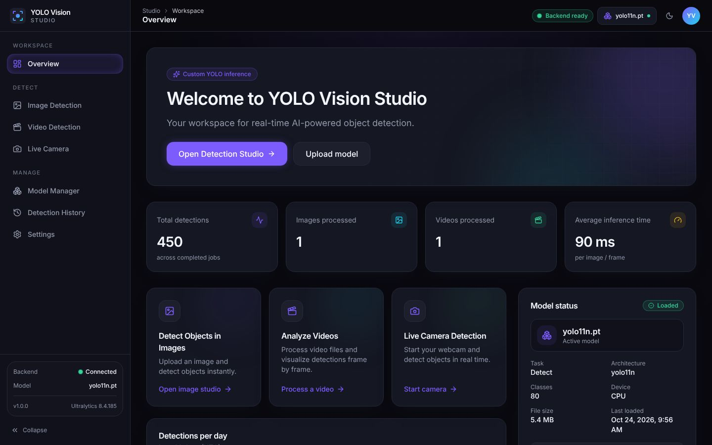
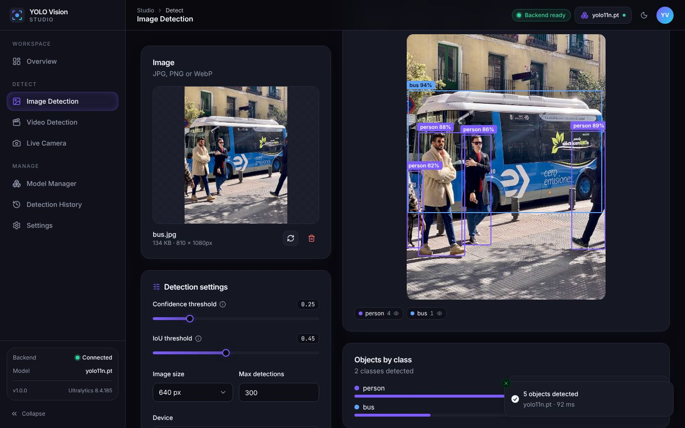
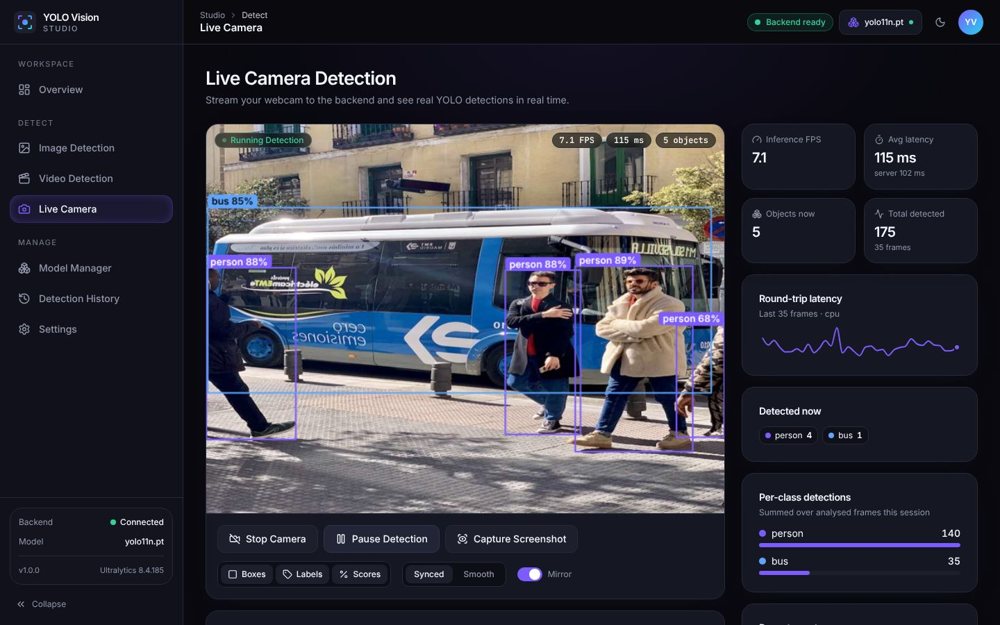
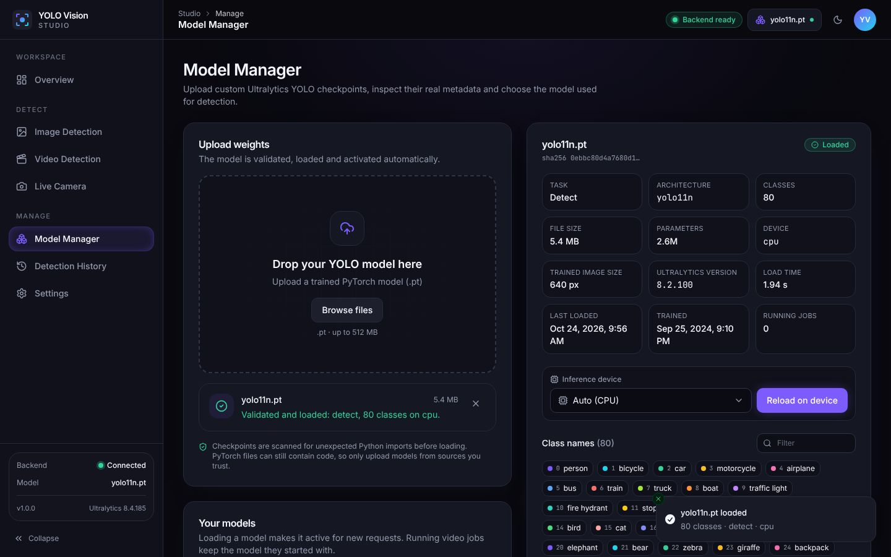
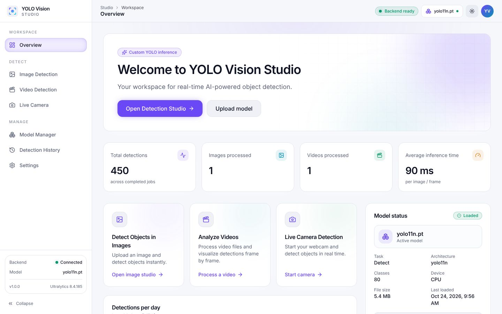

# YOLO Vision Studio

A modern web studio for running **your own Ultralytics YOLO models** (`best.pt`, `yolo11n.pt`, …) on images, videos and a live webcam. Inference is real: a FastAPI backend loads the checkpoint with Ultralytics/PyTorch and the React frontend visualizes the actual detections.



| Image detection | Live camera |
| --- | --- |
|  |  |
| **Model manager** | **Light theme** |
|  |  |

## Features

- **Model Manager**: drag-and-drop `.pt` upload with progress, a security scan of the checkpoint, loading with Ultralytics, a test inference, and real metadata (task, architecture, classes, parameters, device, training image size, Ultralytics version). Load, switch, reload, unload and delete models.
- **Image Detection**: confidence/IoU sliders, image size, max detections, device (Auto/CPU/CUDA) and a class filter built from the model's real classes. Results show as Original / Annotated / Compare views with an interactive overlay (toggle boxes, labels, scores and individual classes), a sortable and filterable results table, a per-class breakdown and an annotated-image download.
- **Video Detection**: background jobs with real progress (frames read/analysed, measured FPS, ETA when the frame count is known, indeterminate otherwise). Frame-sampling strategies, max duration, output quality and resolution, and cancellation. The annotated H.264 MP4 can be previewed and downloaded, and a timeline chart shows objects per frame.
- **Live Camera**: webcam frames stream over a WebSocket at a configurable rate with backpressure (one frame in flight, stale frames dropped). The view shows boxes aligned to the exact analysed frame ("Synced") or a smooth live view, plus live FPS, latency, per-class counts, recent events, mirroring and screenshots.
- **History**: searchable, filterable (type, status, date range) and sortable record of every image, video and live run, with detail view, downloads, and expiry-aware file status.
- **Settings**: backend defaults (thresholds, image size, device, max video FPS), retention and cleanup, storage usage, API URL, health check, theme and display preferences.
- Dark-first design with a light theme, responsive layouts from phone to desktop, reduced-motion support, and skeleton/empty/error states throughout.

## Architecture

```
Browser (React + Vite, static build)            FastAPI backend (Python)
┌──────────────────────────────────┐   REST    ┌──────────────────────────────────────┐
│ Pages: Overview, Image, Video,   │ ────────▶ │ /api/models    model registry + scan │
│ Live, Models, History, Settings  │           │ /api/inference image / video jobs    │
│ React Query · Tailwind · shadcn  │ ◀──────── │ /api/jobs      progress, results     │
│ Radix · Framer Motion · Recharts │ WebSocket │ /api/inference/live  camera frames   │
│ MediaDevices (webcam)            │ ◀───────▶ │ Ultralytics YOLO · PyTorch · OpenCV  │
└──────────────────────────────────┘           │ SQLite history · storage/ directory  │
                                               └──────────────────────────────────────┘
```

PyTorch inference always runs in the Python backend, never in the browser. The frontend builds to static files and reads the API URL from `VITE_API_BASE_URL`.

## Prerequisites

| Tool | Version |
| --- | --- |
| Python | 3.10 – 3.13 |
| Node.js | 20 or newer (22 recommended) |
| ffmpeg | Optional; a bundled binary comes with `imageio-ffmpeg` |
| GPU | Optional; NVIDIA GPU + CUDA build of PyTorch, or Apple Silicon (MPS) |

## Quick start

```bash
git clone <this repo> yolo-vision-studio && cd yolo-vision-studio

# 1. Backend
python3 -m venv backend/.venv
source backend/.venv/bin/activate            # Windows: backend\.venv\Scripts\activate
pip install --upgrade pip
# CPU-only machines (smaller download):
pip install torch torchvision --index-url https://download.pytorch.org/whl/cpu
pip install -r backend/requirements-dev.txt
cd backend && uvicorn app.main:app --reload --port 8000

# 2. Frontend (new terminal)
cd frontend
cp .env.example .env                         # VITE_API_BASE_URL=http://localhost:8000
npm install
npm run dev                                  # http://localhost:5173
```

With `make` available you can run `make setup-backend-cpu setup-frontend` (or `make setup` for the default PyPI PyTorch) and then `make dev`, which starts both servers.

Interactive API docs are served at <http://localhost:8000/docs>.

### PyTorch: CPU vs CUDA

- **CPU only**: use the CPU wheel index shown above. It is much smaller than the default Linux wheel.
- **NVIDIA GPU**: install the CUDA build that matches your driver *before* `requirements.txt`, using the selector at <https://pytorch.org/get-started/locally/>, e.g. `pip install torch torchvision --index-url https://download.pytorch.org/whl/cu124`. The default `pip install torch` on Linux also ships a CUDA build.
- **Apple Silicon**: the default macOS wheel supports MPS. Choose "Apple MPS" as the device.
- Check what the backend sees on the **Settings → Backend** panel, or with `curl localhost:8000/api/health`. If CUDA is unavailable, the CUDA option is disabled in the UI, and a request for it fails with a clear `DEVICE_UNAVAILABLE` error rather than silently falling back to CPU.

## Using the studio

### Upload `best.pt`
1. Open **Model Manager** and drop your checkpoint on "Drop your YOLO model here" (or click **Browse files**).
2. The file uploads with a progress bar. The backend then scans the pickle, loads it with `ultralytics.YOLO`, runs a test inference and extracts the metadata. The new model becomes the **active** model.
3. Incompatible files are rejected with an explanation and not stored. This covers non-checkpoints, classification-only models, YOLOv5-repo checkpoints, files needing a newer Ultralytics, and checkpoints with unexpected Python imports.

Detection, segmentation, pose and OBB models are supported (all produce boxes). Segmentation outlines and pose keypoints are drawn too.

### Run image detection
**Image Detection** → choose a JPG/PNG/WebP → adjust settings → **Run Object Detection**. Hover a table row to highlight its box. Use **Download** for the server-rendered annotated JPEG.

### Process a video
**Video Detection** → choose an MP4/WebM/MOV/MKV/AVI → choose a frame strategy (every frame, every Nth frame, or a target analysis FPS) and output options → **Start Processing**. You can leave the page; the job keeps running and appears in **History** and under "Recent video jobs". Use **Cancel** to stop it. When it finishes, preview the original and annotated videos side by side and click **Download Annotated Video**. Audio is not copied to the output.

### Use the live camera
**Live Camera** → **Start Camera** (the browser asks for permission only now) → **Start Detection**. Settings:
- *Inference frame rate*: the upper bound. With a slow backend the rate drops automatically instead of queueing.
- *Capture resolution* and *JPEG quality*: smaller frames mean lower latency.
- *Synced* shows the exact frame that was analysed with its own boxes. *Smooth* shows live video with the most recent boxes.
- **Capture Screenshot** saves the current frame with annotations as PNG.

Browsers only allow camera access on `https://` pages or `localhost`.

## Configuration

### Backend (`backend/.env`, prefix `YVS_`)

See [`backend/.env.example`](backend/.env.example).

| Variable | Default | Purpose |
| --- | --- | --- |
| `YVS_STORAGE_DIR` | `backend/storage` | Weights, uploads, outputs, SQLite DB, settings |
| `YVS_CORS_ORIGINS` | `http://localhost:5173,…` | Allowed browser origins (REST **and** WebSocket) |
| `YVS_MAX_MODEL_SIZE_MB` / `_IMAGE_` / `_VIDEO_` | 512 / 25 / 1024 | Upload limits |
| `YVS_MAX_IMAGE_PIXELS` | 60 000 000 | Decompression-bomb guard |
| `YVS_MODEL_SECURITY_SCAN` | `true` | Static pickle scan before loading checkpoints |
| `YVS_MAX_LOADED_MODELS` | 2 | Models kept in memory (LRU, active model never evicted) |
| `YVS_AUTOLOAD_LAST_MODEL` | `true` | Reload the active model on startup |
| `YVS_ALLOW_CUDA` | `true` | Set `false` to force CPU |
| `YVS_INFERENCE_TIMEOUT_S` | 120 | Image/live inference timeout (HTTP 504) |
| `YVS_MAX_CONCURRENT_VIDEO_JOBS` | 1 | Worker threads for video jobs |
| `YVS_VIDEO_JOB_TIMEOUT_S` | 21600 | Hard limit per video job |
| `YVS_FRONTEND_DIST_DIR` | – | Serve `frontend/dist` from the API origin |

The backend also sets `YOLO_OFFLINE=true` (no Ultralytics telemetry or downloads) and `YOLO_AUTOINSTALL=false` (checkpoints can never trigger `pip install`). Export different values to override them.

Runtime defaults (thresholds, retention, …) are edited on the **Settings** page and saved to `storage/settings.json`.

### Frontend (`frontend/.env`)

| Variable | Purpose |
| --- | --- |
| `VITE_API_BASE_URL` | Backend URL baked into the build. In dev it defaults to `http://localhost:8000`; in a production build it defaults to the page's own origin. It can be overridden per browser on the Settings page. |

## What is persisted, and where

| Data | Location | Lifetime |
| --- | --- | --- |
| Uploaded weights | `storage/weights/<id>.pt` (server-generated names) | Until deleted in Model Manager |
| Model metadata, active model | `storage/yvs.sqlite3` | Until deleted |
| History (image, video, live runs): metadata, class counts, settings | `storage/yvs.sqlite3` | Up to "History size limit" entries |
| Annotated images, originals, thumbnails, output videos | `storage/outputs/<id>/` | "Output retention" hours, then deleted |
| Uploaded source videos | `storage/uploads/<id>/` | "Uploaded video retention" hours |
| Backend defaults | `storage/settings.json` | Until changed |
| Theme, sidebar, overlay toggles, API URL override | Browser `localStorage` (`yvs-preferences`) | This browser only |
| Current image/result while navigating | In memory | Lost on reload |

History is **backend-persisted** and shared by all browsers using the server. Nothing large (images, video, weights) is ever stored in browser storage. When retention removes files, the entry stays but is marked **Expired**, and its download links disappear.

A cleanup task runs every "Cleanup interval" minutes. You can also start it with **Settings → Run cleanup now** or `POST /api/storage/cleanup`. Files of running jobs are never removed. `make clean-storage` wipes everything.

## API reference

All errors use one envelope: `{"error": {"code": "MODEL_NOT_LOADED", "message": "…", "details": {}}}`.

| Method | Path | Description |
| --- | --- | --- |
| GET | `/api/health` | Status, versions, devices, limits, active model |
| POST | `/api/models/upload` | Multipart `file` (.pt), optional `device`. Validates, loads and activates. 201 |
| GET | `/api/models` | Models + `active_model_id` |
| GET | `/api/models/{id}` | Model metadata |
| POST | `/api/models/{id}/load` | `{"device": "auto|cpu|cuda|mps", "force_reload": bool}` |
| POST | `/api/models/{id}/unload` | Free memory |
| DELETE | `/api/models/{id}` | Delete (409 while a video job uses it) |
| POST | `/api/inference/image` | Multipart `file` + `settings` JSON (+ `model_id`, `save`) |
| POST | `/api/inference/video` | Multipart `file` + `settings` JSON. 202 with a job |
| GET | `/api/jobs` | Queued/running jobs |
| GET | `/api/jobs/{id}` | Status, stage, real progress, result |
| GET | `/api/jobs/{id}/result` | Result of a completed job (409 otherwise) |
| POST | `/api/jobs/{id}/cancel` | Cancel a queued/running job |
| GET | `/api/jobs/{id}/output` · `/input` | Annotated / original video (range requests, `?download=true`) |
| GET | `/api/results/{id}/annotated|original|thumbnail` | Retained image files (410 when expired) |
| GET | `/api/history` | `q`, `kind`, `status`, `date_from`, `date_to`, `sort`, `order`, `limit`, `offset` |
| GET / DELETE | `/api/history/{id}` | Entry detail / delete entry and files |
| DELETE | `/api/history` | Delete all finished entries |
| GET | `/api/stats` | Dashboard totals and per-day counts |
| GET / PUT | `/api/settings` | Runtime defaults (validated); `POST /api/settings/reset` |
| GET | `/api/storage` | Storage usage per area (no paths) |
| POST | `/api/storage/cleanup` | Apply the retention policy now |
| WS | `/api/inference/live` | Live inference, see below |

Inference `settings` keys: `confidence` (0.05–1), `iou` (0.10–0.90), `image_size` (64–1920, multiple of 32), `max_detections` (1–1000), `device`, `classes` (list of class ids). Video jobs add `frame_strategy` (`every_frame|interval|target_fps`), `frame_interval`, `target_fps`, `hold_detections`, `max_duration_s`, `output_quality` (`low|medium|high`), `output_max_height`. Omitted keys use the server defaults.

```bash
curl -F file=@street.jpg -F 'settings={"confidence":0.4,"classes":[0]}' http://localhost:8000/api/inference/image
```

### Live inference protocol (`WS /api/inference/live`)

Client → server:
- **Binary**: 4-byte big-endian frame id, followed by an encoded JPEG/WebP/PNG frame.
- **Text** `{"type":"config","settings":{…InferenceParams}}`: may be sent at any time.
- **Text** `{"type":"ping"}`

Server → client (JSON):
- `{"type":"ready","model":{…}|null,"settings":{…},"max_frame_bytes":n}` on connect
- `{"type":"config_ack","settings":{…}}`
- `{"type":"result","frame_id":n,"width":w,"height":h,"count":n,"detections":[…],"timings":{…},"server_ms":f,"device":"cpu","model":{…},"dropped":n}`
- `{"type":"error","code":"MODEL_NOT_LOADED","message":"…","frame_id":n|null}`
- `{"type":"pong"}`

Coordinates refer to the frame as sent (`width`×`height`). The server keeps only the newest unprocessed frame and drops older ones (`dropped` counts them). The client keeps one frame in flight. Each session is saved to history when the socket closes. Connections from origins outside `YVS_CORS_ORIGINS` are closed with code 1008.

## Security notes

PyTorch `.pt` files are Python pickles. **Loading one can execute arbitrary code.** Ultralytics checkpoints cannot be loaded with `weights_only=True`, so the backend applies defence in depth:

- Only `.pt` files are accepted, the size is limited, and files are stored under random server-generated names in a dedicated directory. Client filenames are used for display only, and API responses never contain filesystem paths.
- Before `torch.load`, the backend opens the zip container and walks the pickle opcodes **without executing them**. A file is accepted only if every import is a known tensor/collection reconstruction helper or a *class* from the neural-network modules of `torch`/`ultralytics`. Anything else is refused: `os.system`, `eval`, `subprocess`, Ultralytics helper functions, `AutoBackend`, extension-registry opcodes, or `getattr` other than the method/enum lookups real checkpoints use. Rejected uploads are deleted.
- `YOLO_AUTOINSTALL=false` stops Ultralytics from `pip install`-ing modules a checkpoint asks for.
- Uploaded images are decoded with a pixel limit, and video jobs have a duration and time limit.

The scan reduces the attack surface but is **not a sandbox**: a determined attacker might still find gadgets inside allowed classes. **Only load models from sources you trust**, run the backend as an unprivileged user, and do not expose it to untrusted users without authentication. If you fully trust your files, set `YVS_MODEL_SECURITY_SCAN=false` to skip the scan. There is no authentication built in; put the app behind your own auth or VPN for shared deployments.

## Testing

```bash
# Backend: 62 tests (health, uploads, validation, security scanner, image inference,
# settings validation, video jobs/cancel, history, retention, live WebSocket, errors)
cd backend && pytest

# Optional: accuracy check with a real COCO-trained checkpoint
YVS_TEST_MODEL=/path/to/yolo11n.pt pytest tests/test_real_model.py

# Frontend: 26 tests (model upload UI, loading/error states, image selection and inference,
# results table, camera permission errors, responsive navigation, palette parity with backend)
cd frontend && npm test
npm run lint && npm run typecheck && npm run build
```

The backend tests need no network or trained model. They build an untrained YOLOv8n from the YAML that ships with Ultralytics, which exercises the full upload, validation, loading, inference and video pipeline.

### Manual checklist (no trained model or GPU required)

Download any official checkpoint (e.g. `yolo11n.pt` from the Ultralytics releases) or use your own `best.pt`.

1. Start both servers. The top bar shows **Backend ready**. Stop the backend and it switches to **Backend offline** within about 15 seconds (or immediately when you run a health check in Settings), with an explanatory banner on the detection pages.
2. Model Manager: upload a `.txt` renamed to `.pt` → it is rejected with "not a PyTorch zip checkpoint". Upload `yolo11n.pt` → progress, then *Validated and loaded*, with 80 classes, task *Detect* and device *cpu*. Upload it again → "already uploaded" with **Load the existing copy**.
3. Image Detection: run on a street photo, then move the confidence slider to 0.9 and rerun → fewer boxes. Pick only `person` in the class filter → only people. Toggle labels/scores/boxes, switch to Compare, hover table rows, download the annotated image.
4. Video Detection: process a short clip → the progress bar advances with real frame counts → Cancel a second run → status *Cancelled*. Download the annotated MP4 and play it.
5. Live Camera: deny camera permission → a clear message is shown. Allow it → **Start Detection** shows FPS/latency badges. Raise the image size to 1280 → FPS drops but latency stays bounded (no queue). Capture a screenshot.
6. History: search, filter by type and date, open entries, delete one. Set "Output retention" to 1 hour, then run cleanup later → entries show **Expired**.
7. Resize the window to phone width: the navigation becomes a drawer, panels stack, and nothing scrolls horizontally.
8. Without a GPU, the CUDA option shows "(unavailable)". With `curl -F 'settings={"device":"cuda"}' …` the API answers `DEVICE_UNAVAILABLE`.

## Troubleshooting

| Problem | Fix |
| --- | --- |
| `RuntimeError: … missing Python dependencies` | Activate `backend/.venv` and `pip install -r backend/requirements.txt` |
| UI shows **Backend offline** | Is uvicorn running on the URL in Settings → Backend? Check `VITE_API_BASE_URL` |
| Browser console: CORS error / live socket closes with 1008 | Add the frontend origin to `YVS_CORS_ORIGINS` and restart the backend |
| `MODEL_REJECTED_UNSAFE` | The checkpoint imports unexpected objects. Re-export it with Ultralytics, or disable the scan for files you trust |
| "original YOLOv5 repository" | Export or retrain with the `ultralytics` package (YOLOv5u/v8/11) |
| `UNSUPPORTED_TASK` | Classification models have no boxes; use a detect/segment/pose/OBB model |
| "needs classes not available" | `pip install -U ultralytics` |
| `DEVICE_UNAVAILABLE` | Choose Auto/CPU, or install a CUDA build of PyTorch |
| `OUT_OF_MEMORY` | Lower image size, use CPU, or reduce `YVS_MAX_CONCURRENT_VIDEO_JOBS` |
| `INFERENCE_TIMEOUT` | Large images on CPU: lower image size or raise `YVS_INFERENCE_TIMEOUT_S` |
| `INVALID_VIDEO` | Re-encode: `ffmpeg -i in.mov -c:v libx264 out.mp4` |
| Annotated video does not play in the browser | Chrome/Edge/Safari/Firefox play H.264. Without ffmpeg the OpenCV fallback may write MPEG-4 Part 2 (download still works) |
| Camera "requires a secure context" | Use `http://localhost` or HTTPS |
| `FILE_EXPIRED` (410) | The retention policy removed the file; rerun the job |

## Production deployment

- **Single origin (simplest)**: `cd frontend && VITE_API_BASE_URL= npm run build`, then start the backend with `YVS_FRONTEND_DIST_DIR=../frontend/dist uvicorn app.main:app --host 0.0.0.0 --port 8000`. The API, WebSocket and UI share one origin, so no CORS setup is needed.
- **Separate hosting**: build with `VITE_API_BASE_URL=https://api.example.com`, serve `frontend/dist` from any static host (configure SPA fallback to `index.html`), and set `YVS_CORS_ORIGINS=https://app.example.com`.
- Put a reverse proxy (nginx, Caddy) in front with TLS (needed for the camera), WebSocket upgrade for `/api/inference/live`, and `client_max_body_size` ≥ your upload limits.
- Run **one** uvicorn worker per GPU. Models, jobs and the job queue live in process memory, so scale by running more instances with separate storage directories, not with more workers on one instance.
- Mount `YVS_STORAGE_DIR` on persistent disk and back up `yvs.sqlite3` if history matters.
- Add authentication in front of the app; see the security notes.

## Project structure

```
yolo-vision-studio/
├── backend/
│   ├── app/
│   │   ├── api/routes/      health, models, inference, jobs, history, settings, live (WS)
│   │   ├── core/            config (env), errors (JSON envelope), utils
│   │   ├── models/          persisted records (SQLite rows)
│   │   ├── schemas/         Pydantic request/response models
│   │   ├── services/        model registry + security scan, inference, annotation,
│   │   │                    video jobs, history, storage/retention, devices
│   │   └── main.py          app factory, CORS, lifespan, cleanup loop
│   ├── storage/             weights/, uploads/, outputs/ (git-ignored contents)
│   ├── tests/               pytest suite
│   ├── requirements.txt     runtime deps (requirements-dev.txt adds pytest/httpx)
│   └── .env.example
├── frontend/
│   ├── src/
│   │   ├── components/      layout, dashboard, model-manager, image-detection,
│   │   │                    video-detection, live-camera, history, detection, charts, ui
│   │   ├── pages/           one file per route
│   │   ├── hooks/           React Query hooks, theme, object URLs
│   │   ├── services/        REST client, upload with progress, errors
│   │   ├── stores/          browser preferences, in-memory workspace
│   │   ├── types/ utils/    API types, formatting, colours, canvas drawing
│   │   └── test/            Vitest + Testing Library
│   └── .env.example
├── docs/screenshots/
├── scripts/dev.sh           run backend + frontend together
└── Makefile
```
